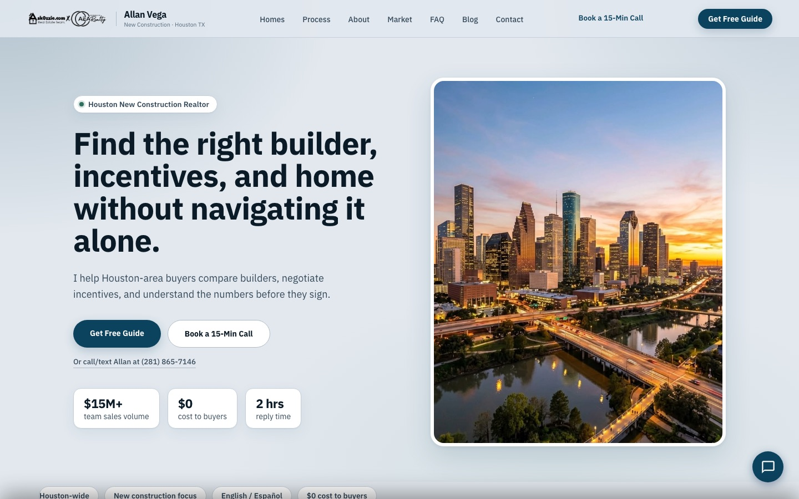

# Houston New Construction Website

**Live site: [allanvrealestate.com](https://allanvrealestate.com)**

The website for my real estate business. It helps Houston-area buyers compare new-construction builders, incentives and neighborhoods. I designed, built and maintain it myself, and I use it to capture buyer leads.

## What it includes

- **20 pages:** a homepage, 11 neighborhood guides (Katy, Cypress, Pearland, Crosby, Baytown and more), buyer guides, a blog and an FAQ.
- **Lead capture:** contact and guide-request forms send submissions to a Google Sheet through Google Apps Script.
- **Search and AI visibility:** a sitemap, robots.txt, an `llms.txt` file, structured page titles and descriptions, and internal links between guides.

## How it works

| Part | What it does |
|---|---|
| `build.py` | Python script that builds the homepage from a template plus the market numbers in `stats.json`, and regenerates the sitemap. |
| `scrape_stats.py` + GitHub Actions | A scheduled monthly job that tries to pull the latest Houston market stats. If the data can't be fetched or looks wrong, the site keeps the last good numbers and opens a GitHub Issue so I can update them by hand. |
| GitHub Pages | Hosts the site on my custom domain. |

## Tools

HTML, CSS, JavaScript, Python, GitHub Actions, GitHub Pages, Google Apps Script. Built with help from AI coding tools (Claude), which I direct, review and test.

## What I learned

- Writing for a real audience: every page answers questions my buyers actually ask.
- Automation needs a fallback. The monthly update checks its own data before publishing and alerts me when something breaks.
- Small, frequent changes (400+ commits) beat big rewrites.

---
Allan Vega · REALTOR®, AEA Realty · TREC #777820 · [LinkedIn](https://www.linkedin.com/in/allan-vega-)
